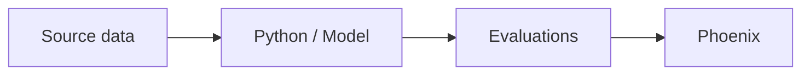

# Enterprise AI Observability — POC v0.1

[Project file index](docs/PROJECT_FILES.md) — locations of research, datasets, reports and installer archives.

Demonstrates **two distinct observability categories** using synthetic data:

- `src/ml_drift.py`: traditional ML drift, changing predictions, and illustrative quality metrics. Saves local JSON/CSV reports. **This is NOT connected to Arize AX.**
- `src/llm_traces.py`: deterministic synthetic RAG-like workflow, traced to **Arize Phoenix** using OTLP/HTTP. Simulates correct and incorrect answers, with a simple deterministic check against an approved synthetic policy. **This does NOT call a real LLM or run a Phoenix-native evaluation.**

## Evaluation workflow



Source data provides the context or observed outcomes. Python runs the model and evaluation steps; Phoenix records traces, scores, and explanations for inspection.

## Requirements

- Python 3.10+ (3.11 or 3.12 recommended)
- Docker and Docker Compose for Phoenix

## Run

```bash
# from the project directory
docker compose up -d
python3.12 -m venv .venv
source .venv/bin/activate  # Windows PowerShell: .venv\\Scripts\\Activate.ps1
pip install -r requirements.txt
python src/ml_drift.py
python src/llm_traces.py
```

Browse **http://localhost:6006**, select your trace project/service, and inspect spans for `agent.answer`, `retrieve_policy`, `generate_response`, and `evaluate_groundedness`. If the UI isn't ready, give the container time to initialize and rerun the trace script.

ML results are saved under `outputs/ml_drift_report.json` plus two CSV files. View with any text editor or spreadsheet application.

On this Mac, `python3` currently points to Python 3.9; use `python3.12` to create the environment. Start OrbStack before running Docker Compose.

## Suggested 5-minute demo

1. Open `outputs/ml_drift_report.json`. Show a changed feature distribution and predicted fraud rates, emphasizing why monitoring model quality requires more than normal application metrics.
2. Open Phoenix and show trace trees for two synthetic answers: one passes the approved-policy check, one fails.
3. Explain how different model categories need distinct telemetry pipelines but share governance, RBAC, retention, cost allocation, and onboarding concerns.

## Limitations, security, next steps

- Educational, simulated data only. No real bank/customer information is used.
- `docker-compose.yml` binds Phoenix to localhost and **does not configure authentication**. Do not expose on a shared network or deploy as production-is.
- `latest` image and loose dependency bounds speed prototyping; pin and verify versions before formal evaluation.
- KS p-values are unadjusted; statistical drift is not the same as concept drift, causal model degradation, or business impact.
- The local ML report **does not demonstrate Arize AX ML monitoring**. To test AX ingestion, obtain an authorized AX workspace and follow its model/prediction ingestion documentation.
- Phoenix traces use manual OTel spans with simulated behavior; replace with a genuine instrumented LLM call and recorded evaluation datasets in the next iteration.
- This POC does **not** establish AX/Phoenix enterprise equivalence or prove multi-tenant isolation.

## References

- Phoenix self-hosting: https://arize.com/docs/phoenix/self-hosting/deploying-phoenix
- Phoenix tracing endpoint: https://arize.com/docs/phoenix/resources/frequently-asked-questions/what-is-my-phoenix-endpoint/
- OpenTelemetry Python documentation: https://opentelemetry.io/docs/languages/python/


## Local model evaluation pilot

Start the Ollama macOS app and Phoenix, then run:

```bash
ollama pull qwen3:4b
.venv/bin/python src/import_usaa_dataset.py
.venv/bin/python src/evaluate_usaa_local.py
```

The pilot uses five questions from the draft USAA dataset, separate curated source paraphrases, and Qwen3 4B for both answers and judging. Reference answers are hidden from the answering step. Two intentionally wrong fixtures check the judge and are excluded from answer pass-rate calculations. Results are saved under `outputs/` and annotated in the `usaa-local-pilot` Phoenix project.

These scores measure agreement with a draft reference on a small convenience sample, not independently verified accuracy. Automatic retrieval, full policy interpretation, and citation entailment are not tested. An exact source-URL check measures presence only. Run results require human review.


## Traditional ML insurance cost evaluation

With the downloaded OpenML ARFF files in `data/insurance/` and Phoenix running:

```bash
.venv/bin/python src/insurance_ml_phoenix.py
.venv/bin/python -m unittest discover -s tests -v
```

For reports without Phoenix, add `--offline`. The default reproducible sample has 120,000 training and 30,000 held-out policies. A regularized Tweedie model predicts recorded policy-period claim cost using exposure. Multiple severity rows are aggregated by policy before joining. IDs and outcome fields are not features.

Open Phoenix's `insurance-traditional-ml` project. The final model version begins `tweedie-p15-alpha1-v1-`; the earlier tree-model run is marked exploratory and superseded. Select a `ml.batch.baseline` or `ml.batch.simulated_inflation` span to inspect metrics and CODE annotations, or `ml.predict_policy` for individual predictions. No LLM judge is involved.

The two batches have identical features, exposure and predictions. The second multiplies actual costs by 1.25, an intentional simulation. Python computes drift statistics and errors; Phoenix stores and displays them as traces and annotations. This is not a native traditional-ML monitoring dashboard. Reports, segment metrics and held-out predictions are saved in a timestamped `outputs/insurance-ml-*` folder. Historical data mismatches and target assumptions are documented in each report.
